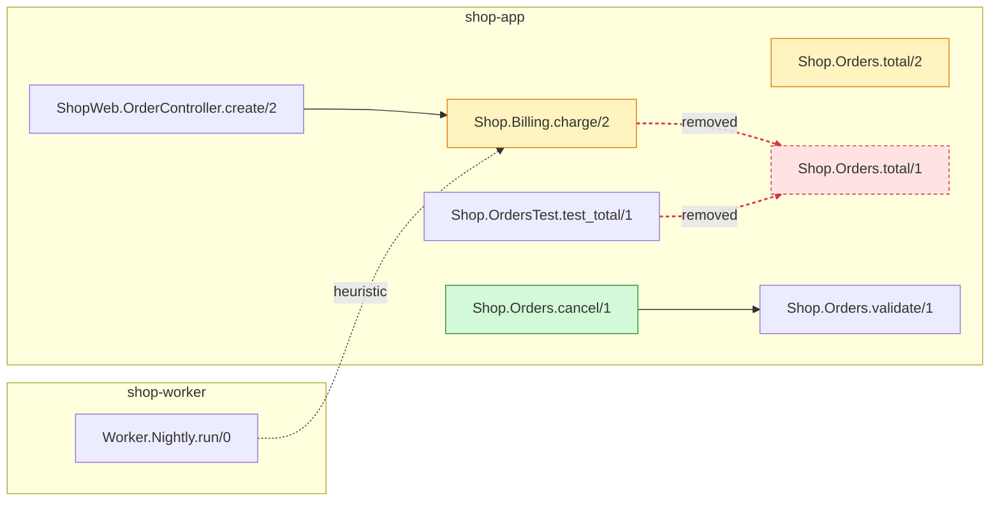

## cartographer impact

**2** changed · **1** added · **0** removed functions · calls **+1 / −2** · **3** callers affected (1 cross-repo) · **1** new table reference(s)

### Changed functions

| Change | Function | Where |
|---|---|---|
| signature | [`Shop.Orders.total`](https://github.com/example/shop-app/blob/cccccccccccccccccccccccccccccccccccccccc/lib/shop/orders.ex#L20) /1 → /2 | shop-app lib/shop/orders.ex:20 |
| body | [`Shop.Billing.charge/2`](https://github.com/example/shop-app/blob/cccccccccccccccccccccccccccccccccccccccc/lib/shop/billing.ex#L5) | shop-app lib/shop/billing.ex:5 |
| added | [`Shop.Orders.cancel/1`](https://github.com/example/shop-app/blob/cccccccccccccccccccccccccccccccccccccccc/lib/shop/orders.ex#L40) | shop-app lib/shop/orders.ex:40 |

### Blast radius (callers in head, depth ≤2)

- [`Shop.OrdersTest.test_total/1`](https://github.com/example/shop-app/blob/cccccccccccccccccccccccccccccccccccccccc/test/shop/orders_test.exs#L6) still calls removed `Shop.Orders.total/1` at test/shop/orders_test.exs:6 (now unresolved)
- d1 [`ShopWeb.OrderController.create/2`](https://github.com/example/shop-app/blob/cccccccccccccccccccccccccccccccccccccccc/lib/shop_web/order_controller.ex#L8) → `Shop.Billing.charge/2` [precise]
- d1 [`Worker.Nightly.run/0`](https://github.com/example/shop-worker/blob/bbbbbbbbbbbbbbbbbbbbbbbbbbbbbbbbbbbbbbbb/lib/worker/nightly.ex#L3) → `Shop.Billing.charge/2` [heuristic] · ⇄ cross-repo

### New table references [candidate]

- `public.orders` ← [`Shop.Orders.cancel/1`](https://github.com/example/shop-app/blob/cccccccccccccccccccccccccccccccccccccccc/lib/shop/orders.ex#L42)

### Call graph

Changed functions and one hop. Dotted red arrows are calls that exist only in base.

base <code>snapshot-20261015T120000Z</code> shop-app@aaaaaaa shop-worker@bbbbbbb → head <code>snapshot-20261016T120000Z</code> shop-app@ccccccc shop-worker@bbbbbbb · cartographer diff
