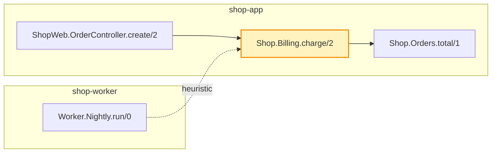

### `Shop.Billing.charge/2` · cartographer

| | |
|---|---|
| Kind | function |
| Location | [`lib/shop/billing.ex:5`](https://github.com/example/shop-app/blob/aaaaaaaaaaaaaaaaaaaaaaaaaaaaaaaaaaaaaaaa/lib/shop/billing.ex#L5) · shop-app |
| Callers | 2 |
| Callees | 1 |
| Cross-repo callers | 1 |
| Unresolved call sites | 2 (dynamic, imported or outside the map) |

**Source** (pinned to the snapshot revisions)

- [`Shop.Billing.charge/2`](https://github.com/example/shop-app/blob/aaaaaaaaaaaaaaaaaaaaaaaaaaaaaaaaaaaaaaaa/lib/shop/billing.ex#L5)
- caller [`ShopWeb.OrderController.create/2`](https://github.com/example/shop-app/blob/aaaaaaaaaaaaaaaaaaaaaaaaaaaaaaaaaaaaaaaa/lib/shop_web/order_controller.ex#L8)
- caller [`Worker.Nightly.run/0`](https://github.com/example/shop-worker/blob/bbbbbbbbbbbbbbbbbbbbbbbbbbbbbbbbbbbbbbbb/lib/worker/nightly.ex#L3) ⇄ cross-repo
- callee [`Shop.Orders.total/1`](https://github.com/example/shop-app/blob/aaaaaaaaaaaaaaaaaaaaaaaaaaaaaaaaaaaaaaaa/lib/shop/orders.ex#L20)

map snapshot-20261015T120000Z · shop-app@aaaaaaa shop-worker@bbbbbbb · <code>cartographer show shop-app:Shop.Billing.charge/2</code>
