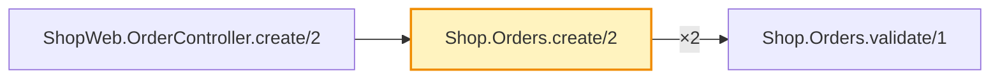

### `public.orders` · cartographer

| | |
|---|---|
| Kind | table |
| Functions | 1 |
| Callers | 1 |
| Callees | 1 |
| Cross-repo callers | 0 |

**Source** (pinned to the snapshot revisions)

- [`Shop.Orders.create/2`](https://github.com/example/shop-app/blob/aaaaaaaaaaaaaaaaaaaaaaaaaaaaaaaaaaaaaaaa/lib/shop/orders.ex#L10)
- caller [`ShopWeb.OrderController.create/2`](https://github.com/example/shop-app/blob/aaaaaaaaaaaaaaaaaaaaaaaaaaaaaaaaaaaaaaaa/lib/shop_web/order_controller.ex#L8)
- callee [`Shop.Orders.validate/1`](https://github.com/example/shop-app/blob/aaaaaaaaaaaaaaaaaaaaaaaaaaaaaaaaaaaaaaaa/lib/shop/orders.ex#L30)

map snapshot-20261015T120000Z · shop-app@aaaaaaa shop-worker@bbbbbbb · <code>cartographer show public.orders</code>
